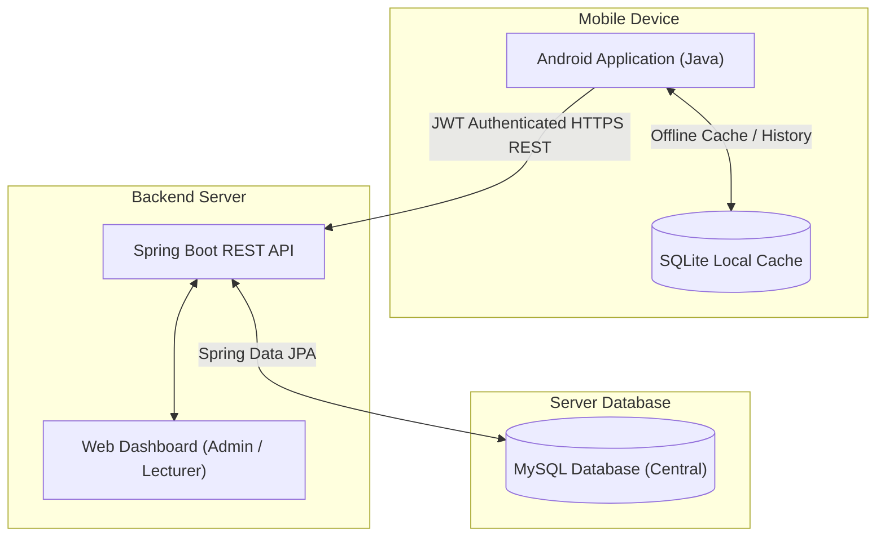

# Smart Attendance Management System (Attendly)
### Using QR Code and Facial Recognition

A full-stack, enterprise-grade automated campus attendance system comprising:
1. **Spring Boot Backend REST API** (Java 17, Spring Boot 3.2.x, Spring Security, JWT)
2. **Interactive Web Dashboard** (Admin & Lecturer Portals with Live QR Projector & Real-time Attendance Monitor)
3. **Native Android Application** (Java, Material Design 3, ML Kit Face Detection, ZXing QR Scanner, SQLite Cache, Retrofit)
4. **Dual Database Architecture** (MySQL Central DB on server + SQLite Local Cache on mobile devices)

---

## 🏗️ System Architecture



---

## 👥 User Roles & Capabilities

| Role | Access | Key Features |
|---|---|---|
| **Student** | Android Mobile App | Sign In, Personal Dashboard, Scan Time-limited QR Code, On-device Face Verification, Instant Attendance Confirmation, History & Percentage, Report Disputed Records |
| **Lecturer** | Web Dashboard & App | Assigned Courses, Start Attendance Session, Project Dynamic Time-limited QR Code (with Auto-Refresh & Countdown Timer), Real-time Live Attendance Monitor, Manual Review & Corrections |
| **Administrator** | Web Dashboard | Manage Student & Lecturer Accounts, Course Catalog & Rosters, Enrollment Management, Institution-wide Attendance Statistics, Audit Logs |

---

## 🔑 Pre-Seeded Demo Accounts

The database automatically seeds with pre-configured accounts matching the UI mockups upon first launch:

| Role | Email | Password | Details |
|---|---|---|---|
| **Administrator** | `admin@university.edu` | `admin123` | System Administrator |
| **Lecturer** | `sarah.lecturer@university.edu` | `password123` | Dr. Sarah Abdullah (Staff ID: `L-2019-CS-0042`) |
| **Student** | `ahmad.student@university.edu` | `password123` | Ahmad Rizwan (Student ID: `S2021-CS-4891`) |

---

## 🚀 How to Run the Backend & Web Dashboard

### Prerequisites
- Java JDK 17 or newer installed.
- (Optional) MySQL Server 8 running on `localhost:3306` with database `smart_attend`.

### Running with MySQL (Default)
1. Ensure MySQL is running and execute `backend/src/main/resources/schema.sql`.
2. Configure credentials in `backend/src/main/resources/application.properties`.
3. In the `backend` folder, run:
   ```powershell
   mvn spring-boot:run
   ```

### Running with In-Memory Database (Zero-Configuration Demo)
To run instantly without installing MySQL:
```powershell
mvn spring-boot:run -Dspring-boot.run.profiles=dev
```
The `dev` profile writes only to an in-memory H2 database; its data will not appear in MySQL and is lost when the backend stops. Use the default MySQL profile for persistent data. Android's SQLite database is only an offline cache; registrations and attendance check-ins are sent to the backend.

### Accessing the Web Dashboard
Open your browser and navigate to:
- **Unified Login / Portal:** [http://localhost:8080/](http://localhost:8080/)
- **Lecturer Portal:** [http://localhost:8080/lecturer.html](http://localhost:8080/lecturer.html)
- **Admin Dashboard:** [http://localhost:8080/admin.html](http://localhost:8080/admin.html)

---

## 📱 How to Run the Android Application

1. Open **Android Studio**.
2. Select **Open an Existing Project** and navigate to `C:\Users\ICT-LAB2\Videos\Smart_Attend\android`.
3. Allow Gradle to sync dependencies.
4. If testing on the **Android Emulator**, the app connects to the backend at `http://10.0.2.2:8080/`.
5. If testing on a **Physical Android Device**:
   - Ensure your computer and device are on the same Wi-Fi network.
   - Update `BASE_URL` in `android/app/build.gradle` with your PC's local IP address (e.g., `http://192.168.1.100:8080/`).
6. Click **Run 'app'** to launch Attendly on your device or emulator.

---

## 🧪 Verification & End-to-End Workflow

1. **Lecturer Starts Session**:
   - Log in to the Web Dashboard as `sarah.lecturer@university.edu`.
   - Click **+ Start New Session** for `CS301 - Data Structures`.
   - The interactive QR code will be projected on screen with a live countdown timer.
2. **Student Scans & Verifies**:
   - Open the Android App and sign in as `ahmad.student@university.edu`.
   - Tap **Scan QR** and scan the projected QR code from the lecturer screen.
   - The app transitions to **Face Verification**. Look directly into the camera oval.
   - ML Kit detects the face and sends verification to the backend.
3. **Attendance Validation**:
   - The backend validates the session, QR token expiry, student enrollment, and ensures **no duplicate check-ins**.
   - Confirmation is displayed on the student's device (`Attendance Recorded! Present ✓`).
   - The Lecturer Web Dashboard immediately updates the **Live Attendance Count** and displays the student's name in real-time.
4. **History & Offline Cache**:
   - The student opens **My History** to view attendance records and semester percentages.
   - Records are cached locally in SQLite for rapid offline viewing.

---

## 🌐 Cloud Hosting & Deployment

For detailed, step-by-step instructions on how to host the **Spring Boot Backend** and distribute the **Android Mobile App** completely **100% free**, refer to the [FREE_HOSTING_GUIDE.md](file:///C:/Users/ICT-LAB2/Videos/Smart_Attend/FREE_HOSTING_GUIDE.md).

